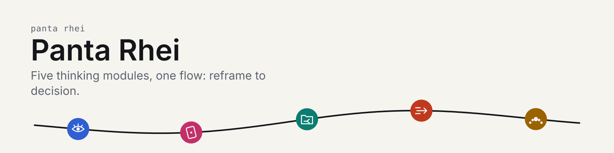
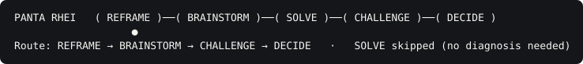

<p align="center"></p>

# Panta Rhei

A thinking-skills pack for Claude, Claude Code and Hermes: reframe, brainstorm, solve, challenge and decide, run end to end.

<p align="center">
  <a href="#install"></a>
  
  
  
</p>

## What it does

Real problems rarely need one method: they need the right problem, then options, then a cause or a test, then a call. Panta Rhei routes a request to the right module, or runs several in order, handing each stage's output to the next. Installed alone it still works, with a compact fallback for any module that is missing.

## Try it

Say any of these after installing:

> Take me from problem to decision on whether to restructure my team
> Which thinking tool should I use for this?
> What are the incentives here? Use that mental model on my situation.

## How it works: The Board

The board shows the five stages with the current one lit and the route chosen for your request. Each stage is owned by a sibling skill; the hub only chooses the order and carries the output across.

<p align="center"></p>

<p align="center"></p>

1. **Show the board:** the five stages and the route.
2. **Pick the route:** only the stages the request needs.
3. **Run the stages:** each module in turn, or its built-in fallback.
4. **Single-model mode:** ask for one of the 100 shared models by what it does.

## Install

**Claude Code**
```
/plugin marketplace add fairyanna85/pantarhei
/plugin install pantarhei-flow@pantarhei
```
This marketplace lists all six skills; install any of them by name.

**Hermes Agent**
```
hermes skills install https://github.com/fairyanna85/pantarhei
```

**Claude apps (web, desktop, mobile)**
1. Download [`pantarhei-flow.zip`](https://github.com/fairyanna85/pantarhei/releases/latest/download/pantarhei-flow.zip).
2. Go to **Customize > Skills**, click **+**, then **+ Create skill**, then **Upload a skill**, and choose the ZIP.
3. Turn the skill on. Code execution and file creation must be enabled (Settings > Capabilities).

**Any Agent Skills client** (Codex, Cursor and others): copy `skills/pantarhei-flow/` into your
client's skills folder.

## What's inside

| Module | Contents | Signature |
|---|---|---|
| Panta Rhei Reframe | 26 lenses | Lens rotation into a one-line problem statement |
| Panta Rhei Brainstorm | 31 methods | Card deck, bursts of ideas, shortlist |
| Panta Rhei Solve | 27 methods | Issue tree, ranked hypotheses, cheapest test |
| Panta Rhei Challenge | 89 methods | Steelman, attacks, survival score |
| Panta Rhei Decide | 31 methods | Council of advisors and a Chair |
| Shared library | 100 models | Mental models used across all five, plus 16 plays |

### The shared library: 100 models

Every module draws on the same 100 mental models. Each one is an audit or a lens with an evidence class and a named failure mode.

- **Map is Not the Territory** — Any model, map or metric is a simplification that leaves things out.
- **Circle of Competence** — Know the areas where your judgment has a track record and where it does not.
- **First Principles Thinking** — Strip a problem down to what is known to be true, discarding convention and analogy, then reason upward from there.
- **Thought Experiment** — Run the scenario in your head: change one variable, imagine the outcome, follow it through.
- **Second-Order Thinking** — Look past the immediate result to the reactions it triggers: who responds, how, and what follows from their response.
- **Probabilistic Thinking** — Treat outcomes as a range with likelihoods rather than as certain or impossible.
- **Inversion** — Approach the problem backwards: ask what would make it fail, or what you want to avoid, then steer away from that.
- **Occam's Razor** — Between explanations that fit the facts equally well, start with the one that needs the fewest extra assumptions.
- **Hanlon's Razor** — Before concluding someone acted out of malice, check whether carelessness, ignorance or confusion would explain it.
- **Relativity** — What you see depends on where you stand.
- **Reciprocity** — People tend to return the treatment they receive, good or bad.
- **Thermodynamics** — Any organised system runs down unless energy is put in to maintain it.
- **Inertia** — Things keep doing what they were doing until a force changes them.
- **Friction and Viscosity** — Resistance drains energy from every movement through a system.
- **Velocity** — Velocity is speed with a direction.
- **Leverage** — A small input in the right place can move something much larger.
- **Activation Energy** — Starting takes more effort than continuing.
- **Catalysts** — A catalyst speeds up a change without being used up by it.
- **Alloying** — Combining ingredients in the right proportions can produce properties none of them has alone.
- **Natural Selection and Extinction** — Variation plus selection by the environment decides what persists.
- **Red Queen Effect** — When rivals keep improving, you have to improve just to hold your position.
- **Ecosystems** — An ecosystem is a web of interdependent parts.
- **Niches** — Fitting a narrow environment well can beat competing broadly.
- **Self-Preservation** — People and organisations act to protect their own survival, status and position.
- **Replication** — Copying a proven approach is often faster and safer than inventing one.
- **Cooperation** — Many results are only possible when parties work together.
- **Hierarchical Organization** — Layered structures let a system scale and specialise, but each layer filters information and adds distance from reality.
- **Incentives** — People respond to what they are rewarded and punished for, not to what they are asked to do.
- **Tendency to Minimize Energy Output** — People and systems tend toward the path of least effort.
- **Feedback Loops** — When an output feeds back as an input, a loop forms.
- **Equilibrium** — Many systems settle into a balance between opposing forces and return to it after small shocks.
- **Bottlenecks** — The output of a whole process is limited by its slowest step.
- **Scale** — Growth changes the problem.
- **Margin of Safety** — Build in more capacity than the expected load requires, to absorb errors and surprises.
- **Churn** — Some customers, staff and components leave every period.
- **Algorithms** — An algorithm is a fixed sequence of steps that turns inputs into outputs.
- **Critical Mass** — Some changes do nothing until a threshold is crossed, then become self-sustaining.
- **Emergence** — Interacting parts can produce behaviour that none of them has alone.
- **Irreducibility** — Some phenomena lose their essential character when broken into parts.
- **Law of Diminishing Returns** — Beyond some point, each additional unit of effort yields less than the last.
- **Sampling** — Conclusions are only as good as the sample behind them.
- **Randomness** — Many outcomes contain a large element of chance.
- **Regression to the Mean** — An extreme result is usually followed by one closer to average, because chance contributed to the extreme.
- **Multiply by Zero** — In a multiplicative system, one factor at zero makes the whole result zero, however strong the others are.
- **Equivalence** — Different inputs or routes can lead to the same result.
- **Surface Area** — The more exposure you have, the more interactions occur, for good and ill.
- **Global and Local Maxima** — A position can be the best within reach and still well below the best available.
- **Scarcity** — When something is in limited supply, people value it more and compete for it.
- **Supply and Demand** — Prices move to balance how much people want something against how much is available.
- **Optimization** — Optimising means choosing the best option for a defined objective under constraints.
- **Trade-offs** — Choosing one option gives up the others.
- **Specialization** — Concentrating on a narrow field builds depth and efficiency, at the cost of flexibility.
- **Interdependence** — Parties that rely on each other gain from cooperation and share each other's failures.
- **Efficiency** — Efficiency is producing the result with the least waste.
- **Debt** — Borrowing brings future resources into the present in exchange for a later obligation with interest.
- **Monopoly and Competition** — Competition pushes prices down and drives improvement; a monopoly captures profits and can fund long bets.
- **Creative Destruction** — New products, firms and methods replace old ones, freeing resources for new uses.
- **Gresham's Law** — Where two kinds of money, or standards, circulate at the same official value, people keep the better one and pass on the worse.
- **Bubbles** — Prices or enthusiasm can rise far beyond underlying value when people buy because others are buying.
- **Audience** — Every message is received by a particular audience with its own knowledge and expectations.
- **Genre** — A genre is a set of conventions that tells the audience what to expect.
- **Contrast** — We judge things relative to what is next to them.
- **Framing** — How a choice is presented changes how people respond to it, even when the facts are the same.
- **Rhythm** — Regular patterns in time organise attention and make things easier to follow.
- **Melody** — A melody is a sequence of notes heard as one shape.
- **Representation** — A representation stands in for something else and always selects and distorts.
- **Plot** — A plot is a chain of events linked by cause, usually driven by conflict toward a resolution.
- **Character** — Character is the pattern of choices a person makes, most visible under pressure.
- **Setting** — The environment sets what is easy, hard or possible.
- **Performance** — A performance happens live, with an audience, and cannot be fully repeated or captured.
- **Seeing the Front** — Reports pass through filters and delays.
- **Asymmetric Warfare** — A weaker party can beat a stronger one by refusing to fight on the stronger party's terms.
- **Two-Front War** — Fighting on two fronts at once splits resources and attention.
- **Counterinsurgency** — Each side's move to gain an edge invites a counter-move, so escalation feeds itself, as in arms races.
- **Mutually Assured Destruction** — When each side can inflict unacceptable damage on the other, both are deterred from attacking.
- **Trust** — Trust lets people and systems cooperate without checking everything, which lowers costs.
- **Bias from Incentives** — People sincerely come to believe what it pays them to believe.
- **Pavlovian Association** — Repeated pairing of a stimulus with an experience makes the stimulus trigger the response on its own.
- **Envy and Jealousy** — People compare their position with others and resent those who have more.
- **Liking/Loving and Disliking/Hating** — We overrate people and things we like and underrate those we dislike, including the evidence they bring.
- **Denial** — When a truth is painful, people avoid seeing it.
- **Availability Heuristic** — We judge how likely something is by how easily examples come to mind.
- **Failure to Account for Base Rates** — Before judging a specific case, start from how often outcomes like it happen in general.
- **Tendency to Stereotype** — Sorting people and things into categories saves effort but erases individual differences.
- **Failure to See False Conjunctions** — A detailed scenario can feel more likely than a broader one that contains it, though it cannot be.
- **Social Proof** — We take others' behaviour as evidence of what is right, especially when unsure.
- **Narrative Instinct** — We understand events as stories with causes, characters and meaning.
- **Curiosity Instinct** — People are driven to explore and understand, beyond immediate need.
- **Language Instinct** — Humans acquire language naturally and think partly through it.
- **First-Conclusion Bias** — The first plausible explanation tends to stop the search for others.
- **Overgeneralization from Small Samples** — A few cases can look like a rule.
- **Relative Satisfaction/Misery** — Satisfaction depends on comparison with expectations, past experience and other people more than on absolute conditions.
- **Commitment and Consistency Bias** — Once people commit, publicly or privately, they tend to act consistently with it even when evidence changes.
- **Hindsight Bias** — Once the outcome is known, it seems to have been predictable all along.
- **Sensitivity to Fairness** — People react strongly to treatment they see as unfair, even at a cost to themselves.
- **Overestimate Consistency of Behavior** — We attribute others' behaviour to their personality and underweight the situation they were in.
- **Influence of Stress** — Under stress, people fall back on habits and quick reactions and are more open to bias.
- **Survivorship Bias** — We see the cases that survived and miss those that failed, so lessons drawn from survivors alone can be wrong.
- **Tendency to Want to Do Something** — There is a strong pull to act, especially when watched or under pressure, even when waiting would be better.
- **Confirmation Bias and Falsification** — We notice and seek evidence that supports what we already think.

## How honest is it?

Every method carries an evidence class (`formal`, `empirical`, `heuristic`, `analogical`) and its
origin, and the skill caps its claims by them. Practitioner methods are labelled as such.
The hub inherits each module's evidence classes and adds none of its own claims.

## The Panta Rhei pack (optional)

Each module works on its own. The pack installs all five plus Panta Rhei, the hub that runs them
end to end.

| | Module | For |
|---|---|---|
| 🔵 | [Panta Rhei Reframe](https://github.com/fairyanna85/pantarhei-reframe) | Working out what the real problem is |
| 🟣 | [Panta Rhei Brainstorm](https://github.com/fairyanna85/pantarhei-brainstorm) | Brainstorming and idea generation |
| 🟢 | [Panta Rhei Solve](https://github.com/fairyanna85/pantarhei-solve) | Structuring and diagnosing problems |
| 🔴 | [Panta Rhei Challenge](https://github.com/fairyanna85/pantarhei-challenge) | Red-teaming ideas and claims |
| 🟡 | [Panta Rhei Decide](https://github.com/fairyanna85/pantarhei-decide) | Making the call |
| ⚫ | [Panta Rhei](https://github.com/fairyanna85/pantarhei) | The pack: all five, end to end |

## Credits and license

Methods are credited to their originators in `catalog.json` and on every card; all descriptions are
our own wording. Code: MIT. Method text: CC BY 4.0. Propose a method: see [CONTRIBUTING.md](CONTRIBUTING.md).
